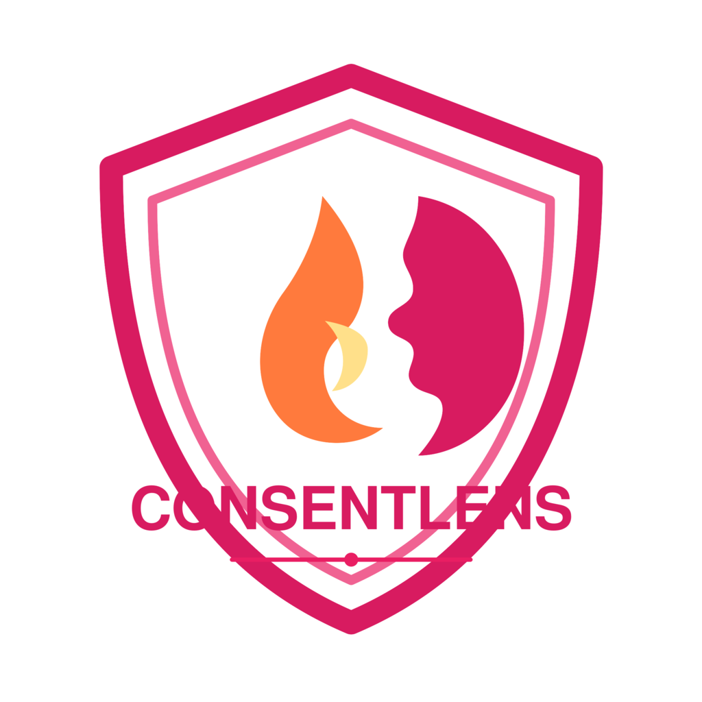
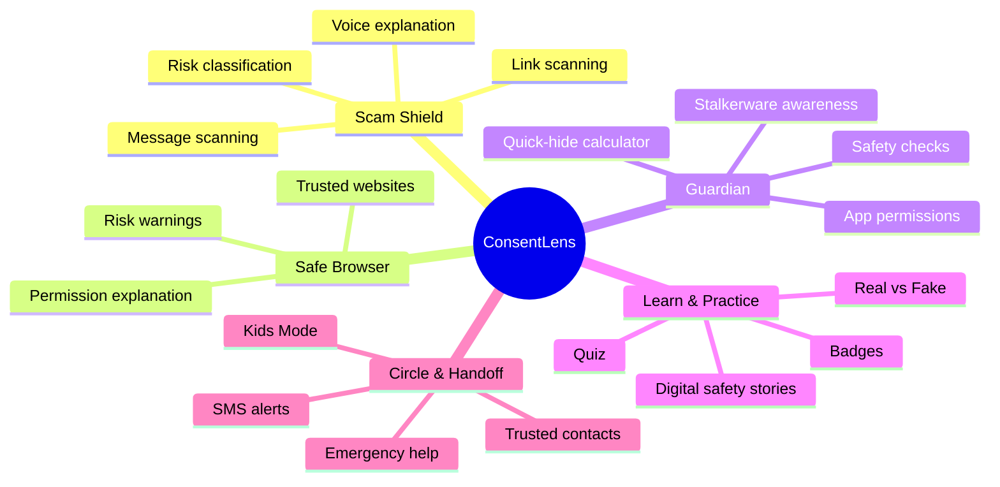
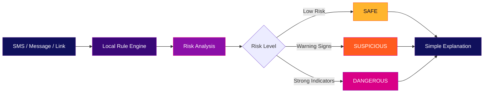
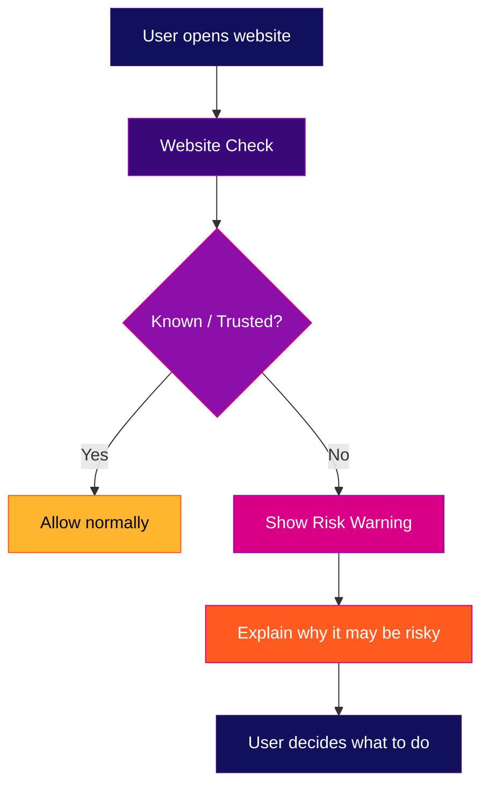
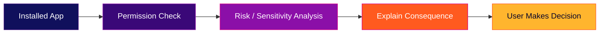
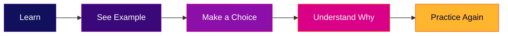
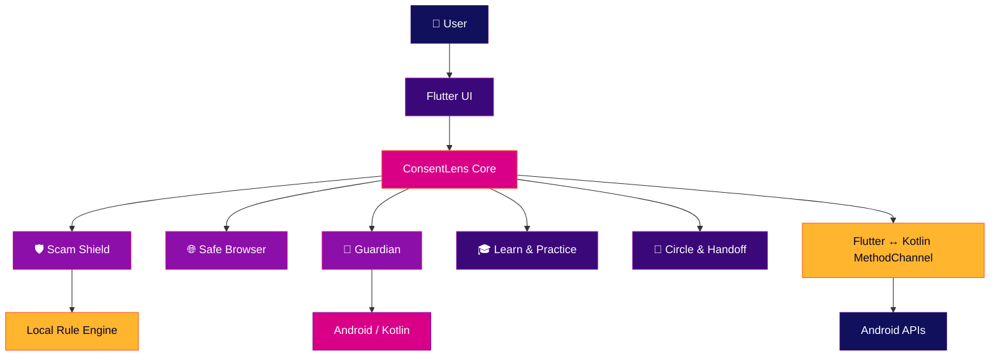
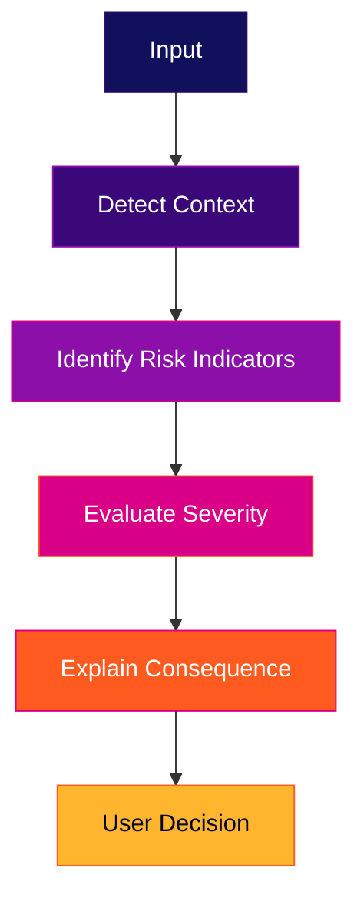

<div align="center">

Made with 💗 for first-time women internet users · **100% on your phone**

</div>
<br></br>
<br></br>
</div>
<div align="center">



# ConsentLens

### Safe Digital Onboarding Kit for First-Time Women Internet Users

**SheSafe Hackathon · RVCE Women in Cloud × DSCI · Team MPOWERNET**

<p>
  
  
  
  
  
</p>

> **Spot the scam. Understand the risk. Stay in control.**

</div>

---

# 🌸 Why ConsentLens?

The internet can be confusing for someone using it for the first time.

A message may look genuine.  
An app may ask for a harmless-looking permission.  
A website may ask for access that the user does not understand.

**ConsentLens helps users understand these risks before they click, install, share, or trust.**

It is designed especially for **first-time women internet users**, with a focus on:

- 🔐 Digital privacy
- 🛡️ Scam awareness
- 📱 Permission understanding
- 👩‍👧 Safe digital onboarding
- ♿ Accessibility
- 🌐 Local-language guidance
- 📵 On-device privacy

### Design Principle

> **Flag and explain — never accuse or automatically act.**

ConsentLens does not simply say *"This is dangerous."*

It explains **why** something may be risky and gives the user enough information to make their own decision.

---

# ✨ The Five Pillars



---

# 🛡️ 1. Scam Shield

The **Scam Shield** helps users understand suspicious messages and links without requiring technical knowledge.

### User Flow



### What it checks

- Suspicious keywords
- Urgency or pressure
- Financial requests
- Fake reward / lottery patterns
- Account verification requests
- Suspicious links
- Impersonation patterns
- Common scam indicators

The result is intentionally simple:

**SAFE → SUSPICIOUS → DANGEROUS**

Instead of overwhelming the user with technical information, ConsentLens converts the result into a **plain-language explanation**.

### Voice Guidance

The verdict can also be communicated through voice in:

**English · Hindi · Kannada**

This helps users who may be less comfortable reading long technical warnings.

---

# 🌐 2. Safe Browser

The Safe Browser provides a controlled browsing experience for users who may not know whether a website is trustworthy.

### How it works



### Key Features

| Feature | Purpose |
|---|---|
| 🌐 Trusted-site handling | Commonly used websites can be accessed normally |
| ⚠️ Risk warnings | Unknown websites receive additional attention |
| 🔎 Site explanation | Users understand why a website may be risky |
| 🔐 Permission awareness | Explains potentially sensitive requests |
| 📱 Simple interface | Designed for first-time users |

The goal is **not to block the internet**.

The goal is to make users **more aware before trusting it**.

---

# 🔎 3. Guardian

The Guardian module focuses on the applications already installed on the device.

Many users tap **"Allow"** without understanding what a permission actually means.

ConsentLens turns technical permissions into understandable consequences.

### Example

Instead of:

> `READ_CONTACTS permission requested`

ConsentLens explains:

> **"This app can access the contacts saved on your phone."**

This creates a bridge between **technical permission → real-world consequence**.

### Guardian Flow



### Safety Checks

- Application permissions
- Sensitive permission combinations
- Suspicious application behaviour
- Stalkerware-related indicators
- Permission risk
- Reversibility of the action

---

# 🚨 Stalkerware Safety

ConsentLens follows an important safety principle:

> **Never tell a potentially monitored user to immediately uninstall suspicious software.**

Removing stalkerware can sometimes alert the person monitoring the device.

Instead, ConsentLens encourages a safer approach:

```text
Identify
   ↓
Document
   ↓
Understand the Risk
   ↓
Seek Trusted Help
   ↓
Take Action Safely
```

This makes the system **safety-aware instead of simply technically correct**.

---

# 🧮 Quick-Hide Mode

ConsentLens can use a **calculator-style interface** as a discreet entry point.

This provides an additional layer of privacy for users who may need to access safety features without drawing attention.

The idea is simple:

**Safety tools should not themselves become a reason for someone to feel unsafe.**

---

# 🎓 4. Learn & Practice

ConsentLens does not only detect problems.

It helps users **learn how to recognise them independently**.

### Learning Modules

| Module | Purpose |
|---|---|
| 📖 Digital Safety Stories | Learn through simple real-life situations |
| 🆚 Real vs Fake | Compare genuine and suspicious examples |
| 🧠 Quiz | Test understanding |
| 🏆 Badges | Encourage continued learning |

### Learning Cycle



---

# 🤝 5. Circle & Handoff

Digital safety becomes stronger when users have someone they trust.

The **Circle & Handoff** module allows users to define trusted people and quickly share an alert when help is needed.

### Features

- Add trusted contacts
- Send SMS alerts
- Share safety information
- Emergency help access
- Parent-controlled Kids Mode
- Safer phone handoff

The system is designed to avoid unnecessary contact access and keep the user in control.

---

# 🏗️ System Architecture

ConsentLens uses a **Flutter frontend with a native Android/Kotlin safety layer**.

The two layers communicate through a **MethodChannel**.



---

# 🔗 Flutter ↔ Kotlin Communication

The application separates the user interface from native Android capabilities.

```text
┌─────────────────────────┐
│       Flutter UI        │
│       Dart Layer        │
└────────────┬────────────┘
             │
             │ MethodChannel
             ▼
┌─────────────────────────┐
│      Native Android     │
│       Kotlin Layer      │
└────────────┬────────────┘
             │
             ▼
┌─────────────────────────┐
│      Android APIs       │
│ Permissions / Security  │
└─────────────────────────┘
```

### Why this architecture?

Flutter handles:

- UI
- Navigation
- User interaction
- Learning modules
- Cross-screen state

Kotlin handles capabilities that require deeper Android integration.

The **MethodChannel** acts as the communication bridge between both layers.

---

# ⚙️ Technology Stack

| Technology | Used For |
|---|---|
| **Flutter** | Cross-platform mobile UI |
| **Dart** | Application logic and UI |
| **Kotlin** | Native Android safety functionality |
| **MethodChannel** | Flutter ↔ Android communication |
| **Android APIs** | Permissions and device-level checks |
| **Local Rule Engine** | Scam and risk detection |
| **On-device Processing** | Privacy-preserving analysis |
| **EN / HI / KN** | Multilingual user guidance |

---

# 🔐 Privacy by Design

Privacy is not an additional feature in ConsentLens.

It is part of the architecture.

### Local-First

Sensitive processing is designed to happen **on the device** wherever possible.

```text
User Data
   ↓
ConsentLens
   ↓
Local Processing
   ↓
Result
```

Not:

```text
User Data
   ↓
Cloud Server
   ↓
External Processing
   ↓
Result
```

### Privacy Principles

| Principle | ConsentLens Approach |
|---|---|
| 🔒 Data minimisation | Only use information required for the feature |
| 📵 Local processing | Sensitive checks stay on-device |
| 🚫 No unnecessary cloud dependency | Core safety logic does not require a server |
| 👤 User control | User decides what action to take |
| 🧠 Explainability | Risks are explained instead of hidden |
| 🔐 No automatic action | The system does not silently act on the user's behalf |

---

# 🧠 Risk & Consent Model

ConsentLens focuses on three important questions:

### 1. What is being requested?

Example:

```text
Camera
Contacts
Location
Microphone
Messages
```

### 2. What could happen?

```text
Permission
   ↓
Potential Access
   ↓
Real-World Consequence
```

### 3. Can the decision be reversed?

ConsentLens considers **risk + consequence + reversibility** rather than treating every permission as equally dangerous.

This helps users make more informed decisions.

---

# 🧩 ConsentLens Decision Model



The system's role is to **support the decision**, not replace the user.

---

# 📁 Project Structure

```text
ConsentLens/
│
├── android/
│   └── Kotlin native safety layer
│
├── assets/
│   ├── branding/
│   ├── illustrations/
│   └── learning/
│
├── lib/
│   ├── core/
│   ├── features/
│   │   ├── scam_shield/
│   │   ├── safe_browser/
│   │   ├── guardian/
│   │   ├── learning/
│   │   └── circle/
│   │
│   ├── services/
│   ├── models/
│   ├── widgets/
│   └── main.dart
│
├── test/
│
├── pubspec.yaml
└── README.md
```

---

# 🚀 Getting Started

### 1. Clone the repository

```bash
git clone https://github.com/harsini2006/ConsentLens.git
cd ConsentLens
```

### 2. Install dependencies

```bash
flutter pub get
```

### 3. Check the Flutter environment

```bash
flutter doctor
```

### 4. Run the application

```bash
flutter run
```

For Android:

```bash
flutter run -d android
```

---

# 📱 Platform

| Platform | Status |
|---|---|
| Android | ✅ Primary platform |
| iOS | ⚪ Not the primary target |

ConsentLens is primarily designed around **Android-native safety capabilities**.

---

# 🔒 Security & Safety Considerations

ConsentLens follows a **user-first safety model**.

### The system should:

- Explain risks clearly
- Avoid unnecessary data collection
- Keep sensitive processing local
- Avoid making accusations without evidence
- Allow users to make the final decision
- Consider physical and social consequences
- Provide safer alternatives where possible

### Especially for vulnerable users

A technically correct action is not always a **safe action**.

For example:

```text
Suspicious App
      ↓
"Uninstall immediately"
      ❌
```

Instead:

```text
Suspicious App
      ↓
Understand
      ↓
Document
      ↓
Get Help
      ↓
Act Safely
      ✅
```

---

# ⚠️ Limitations

ConsentLens is designed as a **digital safety and awareness system**, not a replacement for cybersecurity professionals or emergency services.

Some risks cannot be determined with complete certainty from a message, website, or permission alone.

Therefore, ConsentLens focuses on:

> **Risk awareness + explainability + user control**

rather than claiming perfect detection.

---

# 🔮 Future Improvements

Potential future extensions include:

- More regional languages
- Expanded Indian scam taxonomy
- Improved website reputation checks
- More accessibility features
- Additional Android security checks
- Safer family / guardian workflows
- Offline learning packs
- More detailed risk explanations
- Accessibility support for visually impaired users

---

# 🏆 Hackathon

### SheSafe Hackathon

**Theme:**  
**Digital Trust, Privacy, and Empowerment for First-Time Women Internet Users**

**Team:** MPOWERNET

**Organised by:**  
RVCE Women in Cloud × DSCI

ConsentLens was developed around the idea that **digital safety should be understandable, accessible, and empowering — especially for people entering the digital world for the first time.**

---

# 💡 The Core Idea

```text
Don't just tell users:

        "DANGER!"

Tell them:

        "Here's what is happening."
        "Here's why it may be risky."
        "Here's what it could affect."
        "You decide what to do next."
```

---

<div align="center">

### 🌸 ConsentLens

**Understand before you consent.**

Built with Flutter • Kotlin • Privacy-first design

<br/>

**MPOWERNET · SheSafe Hackathon**

</div>
